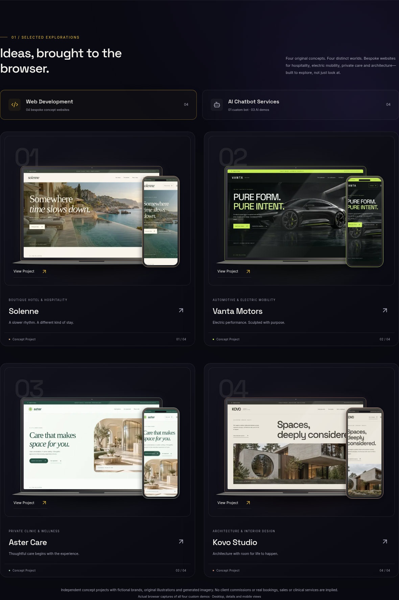

# Elvora — Abdul Hafeez's portfolio

**Launch status:** the requested Next.js 14 release still has reported critical advisories. This is a review build; a patched major-version exception is needed before production. See `SECURITY_STATUS.md`.
Next.js 14 App Router, TypeScript, Tailwind CSS and Framer Motion. All application backend logic runs in Next.js route handlers. Selected Work contains four bespoke fictional websites: Solenne (hotel), Vanta Motors (automotive), Aster Care (private clinic) and Kovo Studio (architecture), each with a working demo and four actual browser-captured gallery images. CSS 3D laptop/phone cards present their desktop and mobile views. The featured Forte O Level Study Assistant card displays a chat preview and opens its in-page Botpress panel with one click anywhere on the card. External chat permission is required before the provider embed loads. The portfolio retains three API chat demos, voice controls, About Me, the supplied Coursiv certificate, domain-email contact and the private PostgreSQL/Prisma/Auth.js admin. Older demos and the Elvora promotional asset are archived and are not selected work.

## Run

Use Node.js 22 or 24. Retain the lockfile.

```bash
npm ci --cache /tmp/portfoli-npm-cache
cp .env.example .env.local
npm run dev
```

Do not overwrite an existing `.env.local`. Set the actual site URL; the example origin is not a deployable value. The public portfolio works with `CONTENT_SOURCE=files` without database/API/mail credentials. The three API demos, mail, uploads and private administration need their own secure settings; unconfigured services report an honest unavailable state.

```bash
npm run test:chat
npm run test:contact
npm run test:security
npm run lint
npm run typecheck
npm run build
npm start
```

`npm ci` generates the Prisma JS-driver client through the pinned Prisma WASM parser. No native Prisma engine is needed at application runtime. Prisma's migration CLI may still download its verified schema engine; allow `binaries.prisma.sh` when running migrations. Never disable checksum checks. Fonts are bundled locally through npm and `next/font/local`.

## Actual concept screenshots

The selected demos are `/demo/solenne`, `/demo/vanta`, `/demo/aster` and `/demo/kovo`. Each has a distinct layout, original generated hero imagery, vector details and working local interactions. Try stay filters/date validation, car model/finish configuration, care-service filtering/sample visit planning and architecture/project-type filtering. All businesses, properties and specifications are fictional. No real bookings, orders, payments, healthcare or enquiries are processed.

```bash
npx playwright install chromium
npm run capture
```

The capture script starts and stops its own development server on port 3100. Stop other Next.js servers first, since development and production share `.next`. Alternatively, set `CAPTURE_BASE_URL` to an already-running app and capture that server. Desktop views are 1440×900, mobile 390×844, both at 2× device scale. `PLAYWRIGHT_CHROMIUM_EXECUTABLE` can select a system Chromium; `/usr/bin/chromium` is detected automatically when present. See `SCREENSHOTS.md` for all 16 filenames and four optional image-generation prompts. Existing captures are included, so a browser installation is not required to run the portfolio.

## Content and data boundaries

All editable portfolio content starts in `data/`. `lib/content-loader.ts` is the server-only boundary: `CONTENT_SOURCE=database` uses Prisma after migrations and seed, while file mode reads the same typed content. Components keep the same display props. Seed is additive and preserves existing records/passwords.

- `data/site.ts`: Elvora identity, Abdul Hafeez's introduction, domain email, navigation and shared UI text.
- `data/projects.ts`, `concepts.ts`, `concept-images.ts`: the four selected concepts, page content, 16 screenshot paths, generated-image prompts and design details. `data/demos.ts` retains archived demos.
- `data/bots.ts`: bot cards, disclosures, one `realBotConfig` object for iframe/script/API, and an optional `additionalBots` list for adding data-configured connections. The real slot connects the supplied Forte O Level Study Assistant Botpress scripts; see `BOTPRESS_SETUP.md`. `data/prompts/` contains the three server-only demo prompts.
- `data/experience.ts`, `skills.ts`: About Me summary, AI workflow explanations and an expanded AI/development toolkit; no invented client counts or testimonials.
- `data/certificates.ts`: supplied Master of ChatGPT certificate details and image, click-to-enlarge/zoom viewer.
- `data/contact.ts`, `admin.ts`: validated form content and admin labels/field definitions.
- `public/portrait-placeholder.svg`: replace with the owner's actual portrait and update its alt/placeholder wording in `data/site.ts`.

The only public contact is **abdulhafeez@elvoraai.online**. No WhatsApp or phone number is displayed. Owner-supplied GitHub and Instagram links are included. The supplied Coursiv Master of ChatGPT certificate is displayed with its 31 October 2024 issue date and 6-hour course duration. About Me summarizes the owner's supplied journey and thoughtful use of AI without metric cards. AI tool names are now included; the personal portrait and genuine testimonials are still pending. See `PART_3.md` for personalization.

## Backend setup

- `CHATBOT_SETUP.md`: real-bot methods, AI keys, shared limits, spending controls and voice limitations.
- `CONTACT_SETUP.md`: Gmail App Password, Turnstile, inbox persistence and delivery semantics.
- `DEPLOYMENT.md`: PostgreSQL, Auth.js, 2FA, uploads, migrations, seeding, Vercel/Netlify, domain/SSL and pre-launch checks.

No production password, API key, database connection or provider token is included. Keep secrets in ignored `.env.local` or hosting secret settings. Do not send passwords in chat.

## Review without downloading



The complete file-by-file source snapshot, starting with the folder structure and Prisma schema, is available in [`delivery/README.md`](delivery/README.md). `VERIFICATION.md` records tested flows and remaining production requirements.

## Studio design and privacy update

Services, a separate My bunch of work contact sheet, eight-tool creative directory, five-step workflow, the owner-supplied journey, one-at-a-time review preview, animated hero emblem and large footer wordmark are configured in `data/studio.ts`. The latest feature update adds categorized skill rows, five technical-domain bento cards, oversized journey typography, an ivory Let’s talk panel, pill footer navigation and a violet wave sign-off. Local tool marks are shared by the skill rows and directory; no new runtime dependency or tracking is introduced. The owner has now supplied the numbered reference images. The latest service grid, horizontal workflow, journey, portrait-left About and editorial footer adapt those compositions to Elvora. The live Framer URL remains blocked here, so exact animation timing is not claimed. See `REFERENCE_DESIGN.md`.

`data/privacy.ts` contains policy copy and consent settings. See `PRIVACY_SETUP.md` for actual behavior and owner review. Four consent parsing tests run with `node --import tsx --test tests/consent.test.ts`. Review/portrait placeholders are explicit; publish only genuine approved material.

The separate My bunch of work collage includes four website concepts plus six new coded UI studies at `/studies/[slug]`. Their snapshots are actual browser captures with fictional data clearly identified. `data/studies.ts` configures the studies and `npx tsx scripts/capture-studies.ts` refreshes their WebP images.

Latest previews: [footer](docs/editorial-footer-desktop.png), [contact](docs/editorial-contact-desktop.png), [skills](docs/editorial-skills-desktop.png), [tools](docs/editorial-tools-desktop.png), [technical domains](docs/editorial-domains-desktop.png), [journey](docs/editorial-journey-desktop.png) and [review layout](docs/editorial-reviews-desktop.png). Matching mobile captures use the same names with `-mobile.png`.
